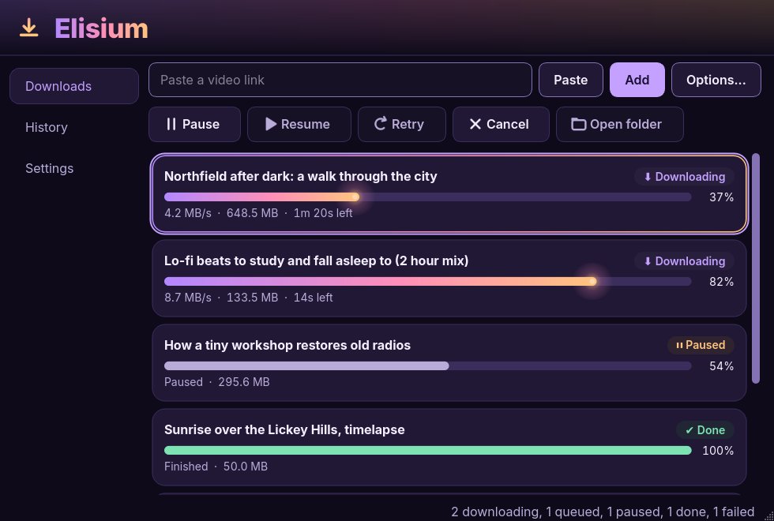
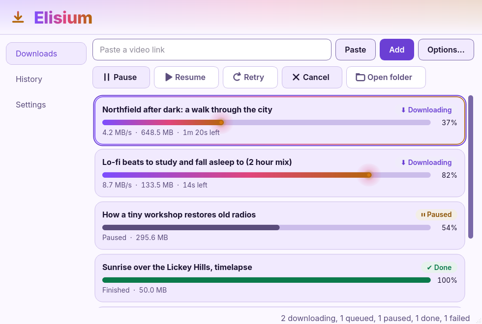
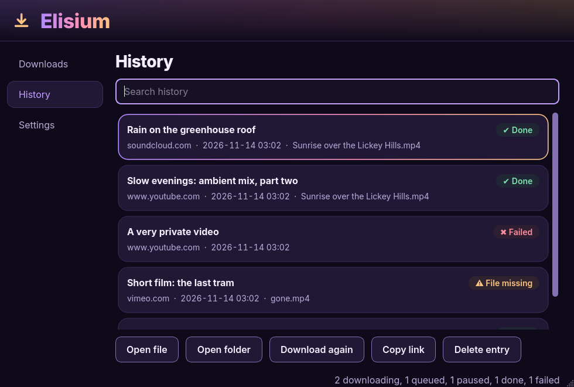
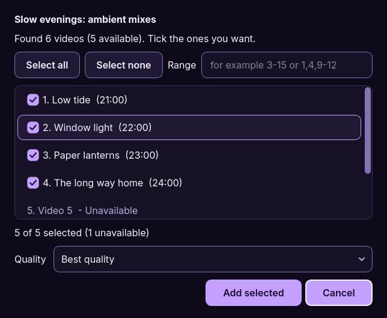

# Elisium

A simple, accessible front end for [yt-dlp](https://github.com/yt-dlp/yt-dlp): paste a video link, pick a quality, get the file. It runs on **Arch Linux** (Qt) and **Android** (Compose). It is a personal project made for the author and friends, so expect rough edges.

- Paste one or many links; duplicates are recognised and never downloaded twice.
- Quality presets (best, 1080p, 720p, audio as MP3/M4A/Opus/FLAC) and a "Choose quality" dialog that lists the exact formats.
- Playlists show a picker with ranges, so nothing huge is queued by accident.
- Queue with pause, resume, retry, cancel; history with search; plain-language error messages.
- Screen-reader friendly (Orca on desktop, TalkBack on Android).

Only download what you have the right to download, and follow the terms of the sites you use.

---

## Android

**Needs:** Android 8.0 or newer, a 64-bit (arm64) phone, a few hundred MB of free space.

1. On your phone, open the [latest release](../../releases/latest) and download `Elisium-*.apk`.
2. Open the downloaded file. Android will ask you to allow installs from your browser or file manager ("Install unknown apps"); allow it for that app, then tap **Install**. It is not on the Play Store.
3. Open **Elisium**. The first start unpacks the download engine, which takes a few seconds.
4. **Add a video:** in YouTube or your browser, tap **Share** and choose **Elisium**, or open Elisium and paste a link in the Downloads tab.
5. Allow notifications when asked, so you can see progress and "finished" messages.

Finished files are saved in **Downloads/Elisium** and show up in your gallery and music app.

Tabs: **Downloads** (queue and progress), **History** (search, open, share, download again), **Settings** (quality preset, how many at once, speed limit, Wi-Fi only, notifications).

> Status: the app is new and has only been tested by automated checks so far. Android screenshots will be added after testing on a real phone. If something breaks, please open an issue and say what you were doing.

---

## Arch Linux

**Needs:** `python`, `pyside6`, `yt-dlp`, `ffmpeg`. For Wayland, also `qt6-wayland`.

```sh
sudo pacman -S pyside6 yt-dlp ffmpeg qt6-wayland
git clone https://github.com/DesolateMartial553/elisium.git
cd elisium
./install-desktop.sh
```

The script installs for your user only (no sudo): the app under `~/.local/share/elisium`, a launcher at `~/.local/bin/elisium`, a menu entry and icon. Make sure `~/.local/bin` is in your `PATH`. Run it again after `git pull` to update.

Start it from your app launcher or with `elisium`. Files are saved in **~/Downloads/Elisium**.

From a terminal or script you can also send links to the running app:

```sh
elisium add https://example.com/some-video
echo "https://example.com/a https://example.com/b" | elisium add -
xdg-open "elisium://add?url=https%3A%2F%2Fexample.com%2Fsome-video"
```

Links are only accepted if they are http or https, and `elisium://` links can only add links (they cannot change settings, folders or yt-dlp options).

### Screenshots (sample data)

Night and Day themes, following your system setting (or choose in Settings).

| Queue (Night) | Queue (Day) |
| --- | --- |
|  |  |

| Choose quality | History |
| --- | --- |
|  |  |

| Settings | Playlist picker |
| --- | --- |
|  |  |

Pick Night, Day or System in Settings, and turn on Reduce motion to stop the glow animation.

---

## Building from source

- Desktop tests: `cd desktop && QT_QPA_PLATFORM=offscreen python -m pytest -q`
- Android: `cd android && JAVA_HOME=/usr/lib/jvm/java-21-openjdk gradle --no-daemon :app:assembleDebug` (needs the Android SDK; `local.properties` with `sdk.dir`).

The design rules shared by both apps live in [`core-spec/SPEC.md`](core-spec/SPEC.md). The `briefs/` folder holds the step-by-step build notes.

Elisium bundles or uses yt-dlp (Unlicense), FFmpeg (LGPL/GPL builds) and, on Android, [youtubedl-android](https://github.com/yausername/youtubedl-android) (GPL-3.0). No licence has been chosen for Elisium's own code yet.
