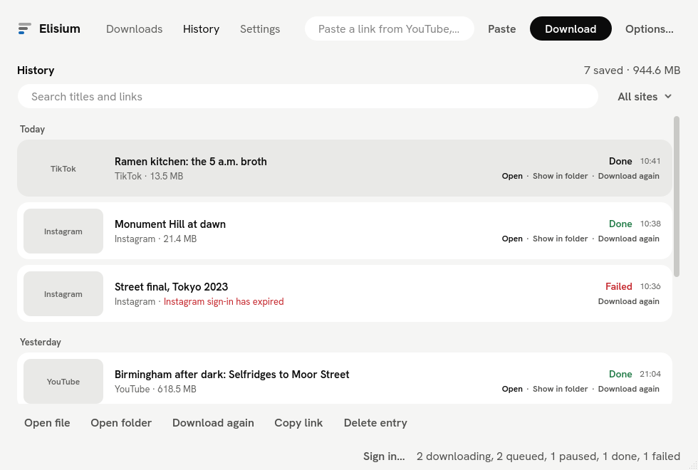
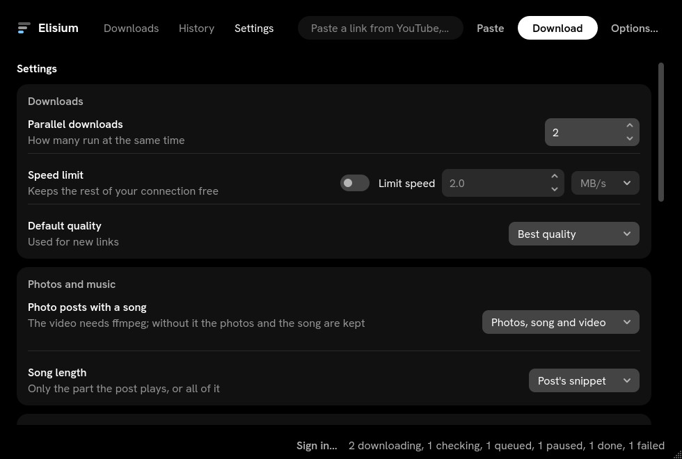
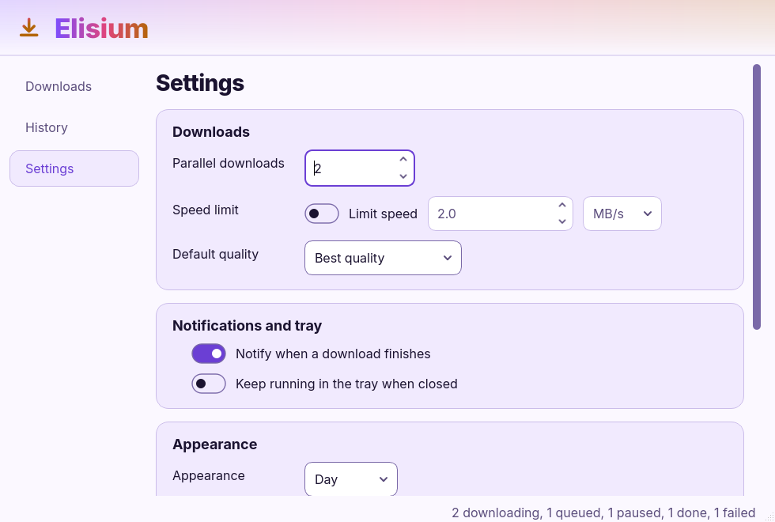
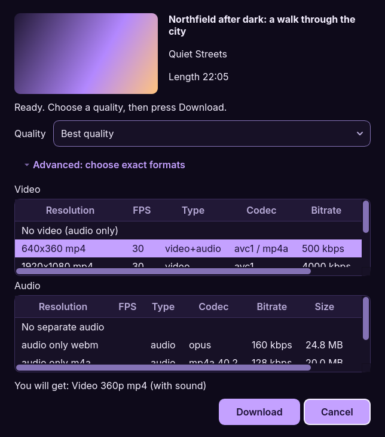
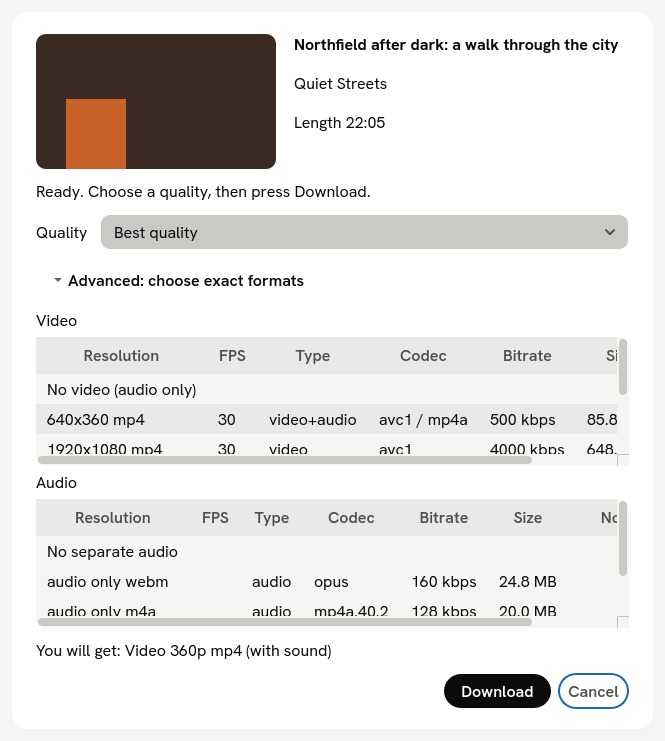
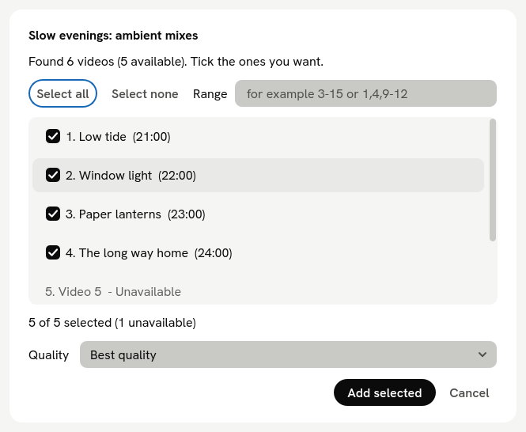

# Elisium

A simple, accessible front end for [yt-dlp](https://github.com/yt-dlp/yt-dlp) and [gallery-dl](https://github.com/mikf/gallery-dl): paste a link, pick a quality, get the file. It runs on **Arch Linux** (Qt) and **Android** (Compose). It is a personal project made for the author and friends, so expect rough edges.

- Paste one or many links; duplicates are recognised and never downloaded twice.
- Videos from YouTube and the many other sites yt-dlp supports, with quality presets (best, 1080p, 720p, audio as MP3/M4A/Opus/FLAC) and a "Choose quality" dialog that lists the exact formats.
- Instagram and TikTok posts: photo posts, carousels, stories, highlights and TikTok slideshows, each saved into a folder named after the account.
- Songs on photo posts: the song is saved cut to the part the post plays, and the photos plus that song are also built into one video. Settings > Photos and music lets you keep only the photos, or the photos and the song, and choose the post's snippet or the full song.
- Playlists show a picker with ranges, so nothing huge is queued by accident.
- Faster downloads (Settings, on by default): each link is looked up once instead of twice, and slow starts say why ("Signing in", "Waiting for the network").
- Queue with pause, resume, retry, cancel; history with search; plain-language error messages; "Download again anyway" when you want a second copy.
- Screen-reader friendly (Orca on desktop, TalkBack on Android).
- One look on both: "Night shelf", a flat black (or light grey by day) interface where your thumbnails do the decorating and colour is used only for progress. Night, Day or follow the system.

Photo posts and stories from Instagram often need you to be signed in (Settings > Accounts). Support for photo posts, stories, slideshows and songs is built and tested against sample data; it has not yet been checked end to end on live Instagram and TikTok, so a site change can break it.

Only download what you have the right to download, and follow the terms of the sites you use.

---

## Android

**Needs:** Android 8.0 or newer, a 64-bit (arm64) phone, a few hundred MB of free space.

1. On your phone, open the [latest release](../../releases/latest) and download `Elisium-*.apk`.
2. Open the downloaded file. Android will ask you to allow installs from your browser or file manager ("Install unknown apps"); allow it for that app, then tap **Install**. It is not on the Play Store.
3. Open **Elisium**. The first start unpacks the download engine, which takes a few seconds.
4. **Add a video:** in YouTube or your browser, tap **Share** and choose **Elisium**, or open Elisium and paste a link in the Downloads tab.
5. Allow notifications when asked, so you can see progress and "finished" messages.

Finished files are saved in **Downloads/Elisium** (photo posts and stories in **Downloads/Elisium/<account>/**) and show up in your gallery and music app.

Tabs: **Downloads** (queue and progress), **History** (search, open, share, download again), **Settings** (quality preset, how many at once, speed limit, Faster downloads, photos and music, Wi-Fi only, notifications, Instagram sign-in).

> Status: the app is new and has only been tested by automated checks so far, not yet on a real phone. If something breaks, please open an issue and say what you were doing.

---

## Arch Linux

**Needs:** `python`, `pyside6`, `yt-dlp`, `ffmpeg`. Photo posts, stories and slideshows also need `gallery-dl` (the video-with-a-song feature uses `ffmpeg`). For Wayland, also `qt6-wayland`.

```sh
sudo pacman -S pyside6 yt-dlp ffmpeg gallery-dl qt6-wayland
git clone https://github.com/DesolateMartial553/elisium.git
cd elisium
./install-desktop.sh
```

(Alternatively, build a proper package: `sudo pacman -S --needed base-devel git python-build python-installer python-setuptools python-wheel` then `cd packaging/arch && makepkg -si`. This PKGBUILD is not yet tested end to end.)

The script installs for your user only (no sudo): the app under `~/.local/share/elisium`, a launcher at `~/.local/bin/elisium`, a menu entry and icon. Make sure `~/.local/bin` is in your `PATH`. Run it again after `git pull` to update.

Start it from your app launcher or with `elisium`. Videos are saved in **~/Downloads/Elisium**; photo posts and stories go in a folder per account inside it (**~/Downloads/Elisium/<account>/**).

From a terminal or script you can also send links to the running app:

```sh
elisium add https://example.com/some-video
echo "https://example.com/a https://example.com/b" | elisium add -
xdg-open "elisium://add?url=https%3A%2F%2Fexample.com%2Fsome-video"
```

Links are only accepted if they are http or https, and `elisium://` links can only add links (they cannot change settings, folders or yt-dlp options).

### Screenshots (sample data)

Night and Day themes, following your system setting (or choose in Settings).

| Queue (Night) | Queue (Day) |
| --- | --- |
|  |  |

| History (Night) | History (Day) |
| --- | --- |
|  |  |

| Settings (Night) | Settings (Day) |
| --- | --- |
|  |  |

| Choose quality (Night) | Choose quality (Day) |
| --- | --- |
|  |  |

| Playlist picker (Night) | Playlist picker (Day) |
| --- | --- |
|  |  |

Pick Night, Day or System in Settings, and turn on Reduce motion to stop the animations. The queue screenshot above uses sample rows; the live app also shows thumbnails and file counts for photo posts.

---

## Building from source

- Desktop tests: `cd desktop && QT_QPA_PLATFORM=offscreen QT_QPA_PLATFORMTHEME= python -m pytest -q`
- Android: `cd android && JAVA_HOME=/usr/lib/jvm/java-21-openjdk gradle --no-daemon :app:assembleDebug` (needs the Android SDK; `local.properties` with `sdk.dir`).

The behaviour shared by both apps lives in [`core-spec/SPEC.md`](core-spec/SPEC.md) and the look in [`design/DESIGN.md`](design/DESIGN.md). The `briefs/` folder holds the step-by-step build notes.

Elisium is free software under the [GNU GPL v3](LICENSE) or later. On the desktop it bundles the Hanken Grotesk typeface (SIL Open Font License, see `desktop/elisium_downloader/ui/fonts/OFL-HankenGrotesk.txt`); the Android app bundles it too. It uses yt-dlp (Unlicense), gallery-dl on the desktop (GPL-2.0), FFmpeg (LGPL/GPL builds) and, on Android, [youtubedl-android](https://github.com/yausername/youtubedl-android) (GPL-3.0).
